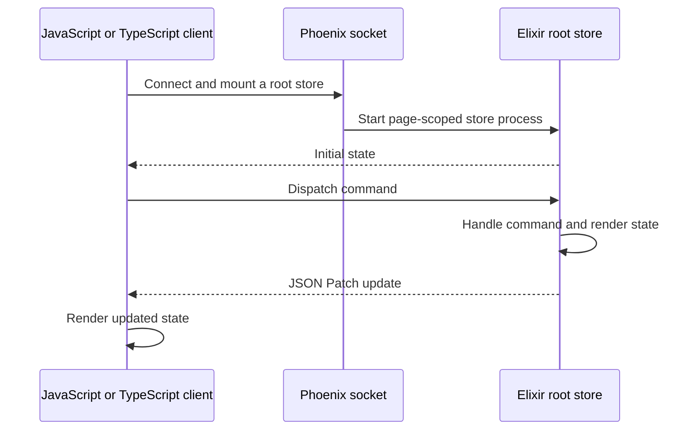

What if your frontend could receive **live data** from Elixir, the way Phoenix LiveView keeps a page up to date—but render it with the JavaScript frontend of your choice?

[Musubi](https://github.com/fahchen/musubi) explores that idea. LiveView renders the interface on the server and sends updates to the browser. Musubi keeps state and command handling on the server, then sends state updates to the frontend. Its `@musubi/client` package works with TypeScript and JavaScript frontends, including Vue or other frameworks; `@musubi/react` provides a dedicated React client with context and hooks.

I built it because I wanted to use both ecosystems: Elixir and Phoenix for the server, and JavaScript libraries and tools for the frontend.

## How it works

A Phoenix socket carries a Musubi connection. The client mounts a declared root store, and Musubi starts a page-scoped server process for it. The store handles commands and renders state; the client receives that state and subsequent JSON Patch updates.



The server owns the state, but the client decides how to render it. A connection can mount multiple root stores, and stores can render child stores for parts of a page.

## A small counter

A store declares the state it exposes and the commands it accepts. Here is a minimal counter:

```elixir
defmodule MyAppWeb.Stores.CounterStore do
  use Musubi.Store, root: true

  state do
    field :count, integer()
  end

  command :increment do
    payload do
      field :amount, integer()
    end
  end

  @impl Musubi.Store
  def mount(params, socket) do
    {:ok, assign(socket, :count, Map.get(params, "count", 0))}
  end

  @impl Musubi.Store
  def render(socket), do: %{count: socket.assigns.count}

  @impl Musubi.Store
  def handle_command(:increment, %{"amount" => amount}, socket) do
    {:noreply, update(socket, :count, &(&1 + amount))}
  end
end
```

After exposing the store through a Musubi socket, use the framework-independent `@musubi/client` to connect, mount it, and send commands:

```ts
import { connect } from "@musubi/client"

const connection = await connect<Musubi.Stores>(socket)

const { store: counter, unmount } = await connection.mountStore({
  module: "MyAppWeb.Stores.CounterStore",
  id: "counter",
  params: { count: 1 },
})

await counter.dispatchCommand("increment", { amount: 1 })
await unmount()
```

The server handles the increment and sends the resulting state change to the client. Musubi can generate TypeScript declarations from store definitions, so the client can use the store and command types in its editor.

For React, `@musubi/react` builds on the same client and provides a provider and hooks for working with connections, stores, snapshots, and commands. Other frameworks can integrate directly with `@musubi/client`.

## Building interactive applications

A real application needs more than a single value. Musubi provides tools for common interactions:

- **Streams:** keep collections such as chat messages up to date with keyed inserts, updates, and deletes. The client holds the items; the server keeps stream configuration and pending operations rather than retaining the collection as stream state.
- **Push events:** send a transient signal, such as a toast, from a store to its connected client. These events are not durable and are not replayed after a disconnect.
- **Async values:** expose loading, success, and failure states while work runs on the server.
- **Uploads:** accept files with progress reporting, including support for application-provided external uploaders.
- **Child stores:** split a page into smaller server-owned pieces, each with its own state and behavior.
- **Client packages:** `@musubi/client` handles the connection, patches, and store proxies. `@musubi/react` builds on it with a provider and hooks for mounting stores, reading snapshots, and dispatching commands. Generated TypeScript declarations describe stores and commands.

These are runtime tools rather than automatic persistence. Your application still owns its domain logic, database, authentication, and cross-connection broadcasts.

## Musubi in use

I use Musubi in two other projects:

- [Suikou](https://github.com/fahchen/suikou), a review workbench where a React frontend reads and updates server-owned review state.
- [redbug-cli](https://github.com/fahchen/redbug-cli), a terminal UI for tracing Erlang and Elixir nodes. Its Elixir controller owns state and talks to a React-based terminal client.

## Try Musubi

Musubi is pre-1.0, so its APIs may still change. If you are building with Phoenix and want a JavaScript or TypeScript interface backed by server-owned state, explore the [repository](https://github.com/fahchen/musubi) and the [documentation](https://hexdocs.pm/musubi).
