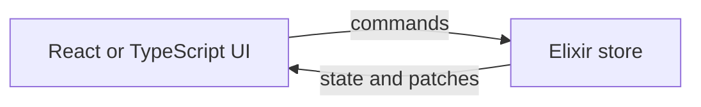

I built [Musubi](https://github.com/fahchen/musubi) for applications where I want Elixir and Phoenix to own the state, while a TypeScript or React client owns the interface.

Phoenix LiveView makes server-driven interfaces feel natural, but sometimes I want to build the UI with React. Musubi offers a way to keep state and business logic on the server without giving up that choice of client.

## How it works

A Phoenix socket carries a Musubi connection. The client mounts a declared root store, and Musubi starts a page-scoped server process for it. The store handles commands and renders state; the client receives that state and subsequent JSON Patch updates.



The server owns the state, but the client decides how to render it. A connection can mount multiple root stores, and stores can render child stores for parts of a page.

## A small counter

A store declares the state it exposes and the commands it accepts. Here is a minimal counter:

```elixir
defmodule MyAppWeb.Stores.CounterStore do
  use Musubi.Store, root: true

  state do
    field :count, integer()
  end

  command :increment do
    payload do
      field :amount, integer()
    end
  end

  @impl Musubi.Store
  def mount(params, socket) do
    {:ok, assign(socket, :count, Map.get(params, "count", 0))}
  end

  @impl Musubi.Store
  def render(socket), do: %{count: socket.assigns.count}

  @impl Musubi.Store
  def handle_command(:increment, %{"amount" => amount}, socket) do
    {:noreply, update(socket, :count, &(&1 + amount))}
  end
end
```

After exposing the store through a Musubi socket, the TypeScript client connects, mounts it, and sends commands:

```ts
const connection = await connect<Musubi.Stores>(socket)

const { store: counter, unmount } = await connection.mountStore({
  module: "MyAppWeb.Stores.CounterStore",
  id: "counter",
  params: { count: 1 },
})

await counter.dispatchCommand("increment", { amount: 1 })
await unmount()
```

The server handles the increment and sends the resulting state change to the client. Musubi can generate TypeScript declarations from store definitions, so the client can use the store and command types in its editor.

## More than a counter

Musubi also provides building blocks for common interactive applications:

- **React integration:** hooks for mounting stores, reading snapshots, and dispatching commands.
- **Child stores:** organise a page into smaller server-driven pieces.
- **Async work and streams:** represent work that completes over time.
- **Uploads and push events:** handle file uploads and send transient events to the client.

These are runtime tools rather than automatic persistence. Your application still owns its domain logic, database, authentication, and cross-connection broadcasts.

## Try Musubi

Musubi is pre-1.0, so its APIs may still change. If you are building with Phoenix and want a TypeScript or React interface backed by server-owned state, explore the [repository](https://github.com/fahchen/musubi) and the [documentation](https://hexdocs.pm/musubi).
