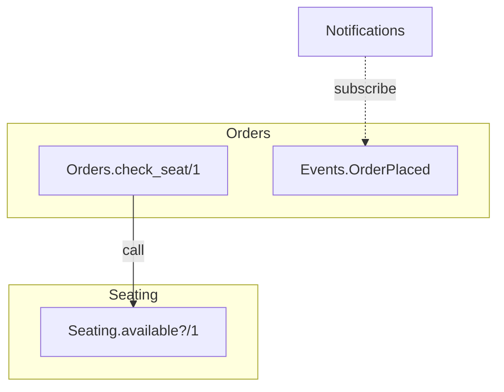
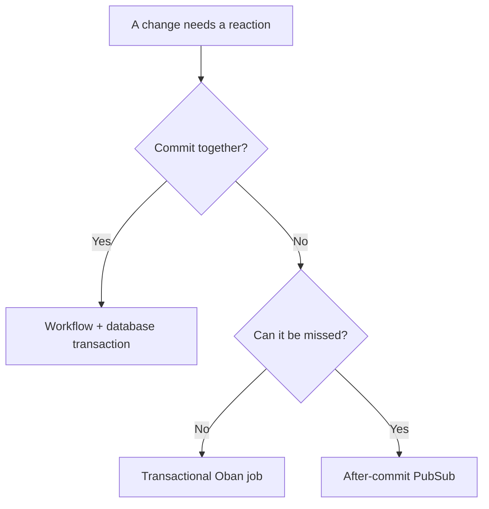

As an application grows, a change in one part of the domain often needs work elsewhere. The challenge is to coordinate that work without making every context depend on every other one—and without losing track of which changes must succeed together.

## The problem and dependency direction

Tickets for a favorite artist go on sale. A customer picks a seat and places an order. Behind that one click, the application has to know whether the seat is available, reserve it, create the order, and send a confirmation.

The work crosses three **bounded contexts**: boundaries within which a domain model and its language have a clear meaning. **Seating** owns availability and reservations. **Orders** uses Seating's public API to check availability and owns the order. **Notifications** reacts when an order is placed. These are boundaries in the model, not merely names for database tables.

A direct implementation might put the whole purchase inside Orders:

```elixir
defmodule MyApp.Orders do
  alias MyApp.{Notifications, Seating}

  def place_order(attrs) do
    with {:ok, order} <- create(attrs),
         {:ok, _reservation} <- Seating.reserve(order.seat_id),
         :ok <- Notifications.send_confirmation(order.id) do
      {:ok, order}
    end
  end
end
```

This is straightforward, but Orders now knows who reacts to an order. If Notifications also reads the order from Orders, the contexts depend on each other. Every additional reaction asks Orders to name another consumer. A synchronous call can be appropriate, but here it obscures which work must be atomic and ties the producer to its consumers.

We can keep that responsibility outside Orders and reverse the consumer dependency. This simplified context relationship map shows the intended dependencies; a fuller DDD context map also captures how teams and models integrate:



A solid arrow shows a public API call: `Orders.check_seat/1` calls `Seating.available?/1`. A dashed arrow shows Notifications depending on the event contract owned by Orders. In the implementation below, the subscriber reads the serialized event name and payload, so this is a contract dependency rather than necessarily a compile-time dependency on the event module. Event data flows from Orders to Notifications, opposite to that contract dependency. Orders does not call Notifications.

The arrows show the dependencies, but not the whole purchase. How can the order and reservation succeed or fail together without either context coordinating the other’s write? And how do other parts of the application find out that an order was placed?

## Choosing a consistency guarantee

Use the required consistency to choose how a reaction happens:



A database transaction covers only work in that transaction. For durable jobs, plan for retries, exhausted jobs, and duplicate external effects. “Can it be missed?” means the loss is acceptable, or the consumer has a reliable way to recover current state. Use PubSub only in those cases.

## Worked example: buying a ticket

### One purchase, different guarantees

The following snippets are illustrative; they omit application-specific schemas, facade implementations, and LiveView subscription setup.

The purchase workflow coordinates the writes without making Orders call Notifications. Orders can still read Seating’s availability API. In DDD terms, the workflow acts as an **application service**: it coordinates the use case while the contexts own their business rules.

```elixir
defmodule MyApp.Workflows.PlaceOrder do
  alias MyApp.{EventBus, Orders, Repo, Seating}
  alias MyApp.Orders.Events.OrderPlaced

  def run(attrs) do
    result =
      Repo.transact(fn ->
        with {:ok, order} <- Orders.create(attrs),
             {:ok, _reservation} <- Seating.reserve(order.seat_id),
             {:ok, _jobs} <- EventBus.publish(%OrderPlaced{order_id: order.id}) do
          {:ok, order}
        end
      end)

    case result do
      {:ok, order} ->
        Phoenix.PubSub.broadcast(MyApp.PubSub, "seats", {:seat_changed, order.seat_id})
        {:ok, order}

      {:error, reason} ->
        {:error, reason}
    end
  end
end
```

Each step has a different requirement:

<table>
  <thead><tr><th>Step</th><th>What happens if it fails?</th><th>What we need</th></tr></thead>
  <tbody>
    <tr><td>Reserve the seat</td><td>An order without a seat cannot stand</td><td>Order and reservation commit together</td></tr>
    <tr><td>Send confirmation</td><td>The order can stand; the email still needs attention</td><td>A durable reaction after commit</td></tr>
    <tr><td>Refresh the seat map</td><td>A missed refresh is acceptable if the view reloads</td><td>A transient notification</td></tr>
  </tbody>
</table>

Order creation, reservation, and subscriber-job insertion share one transaction. The email is sent later, and the PubSub refresh is best-effort. Let’s follow each step.

### Coordinate an atomic change

The workflow calls each context's public API inside one transaction. Orders creates the order; Seating decides whether the seat can be reserved. If Seating returns an error, the order rolls back too.

Checking availability before the purchase is useful for the UI, but it is not enough to protect the reservation: two buyers can see the same available seat. Seating must make the final check and update atomically:

```elixir
defmodule MyApp.Seating do
  import Ecto.Query
  alias MyApp.Repo
  alias MyApp.Seating.Seat

  def reserve(seat_id) do
    {count, _} =
      Seat
      |> where([seat], seat.id == ^seat_id and seat.status == :available)
      |> Repo.update_all(set: [status: :reserved])

    case count do
      1 -> {:ok, :reserved}
      0 -> {:error, :seat_unavailable}
    end
  end
end
```

Only one competing update can change an available seat to reserved. The other returns `:seat_unavailable`, so its workflow rolls back the order. This sketch assumes a unique seat ID and that both contexts use the same repository and database transaction.

The workflow knows both contexts, but it does not own their rules: Seating protects its reservation invariant, while Orders manages the order. Neither context needs to call the other to coordinate the write.

> **Transaction boundaries:** Each context’s public operations must protect their own invariants, whether called alone or from a workflow. A single database update may be atomic on its own; an operation with several dependent writes needs a transaction. Read operations should state their consistency needs, but do not always need a transaction.
>
> When the workflow and facade use the same Ecto repository and process, an inner `Repo.transact` joins the outer transaction. A successful inner call commits only with the outer one, and errors must propagate so the workflow rolls back. This does not create an independent savepoint or roll back external requests.

### Durable reactions

#### Define the event contract

> **Domain event and job:** `OrderPlaced` is a fact owned by Orders. The Oban job carries work to a subscriber; it is not the domain event itself.

The bus uses an Elixir **protocol** to obtain a stable name and a JSON-encodable payload from each event:

```elixir
defprotocol MyApp.EventBus.Event do
  def name(event)
  def payload(event)
end

defmodule MyApp.Orders.Events.OrderPlaced do
  @enforce_keys [:order_id]
  defstruct [:order_id]
end

defimpl MyApp.EventBus.Event, for: MyApp.Orders.Events.OrderPlaced do
  def name(_event), do: "orders.order_placed"
  def payload(event), do: %{order_id: event.order_id}
end
```

`@enforce_keys` checks required keys in literal struct construction at compile time. It does not validate types or job payloads; subscribers still validate incoming data at runtime.

#### Register and enqueue subscribers

The event bus owns the subscriber registry. The example uses one Oban job per subscriber, so one subscriber's failure does not retry another's completed job:

```elixir
defmodule MyApp.EventBus do
  alias MyApp.EventBus.Event
  alias MyApp.Notifications.OrderPlacedSubscriber
  alias MyApp.Orders.Events.OrderPlaced

  @subscribers %{OrderPlaced => [&OrderPlacedSubscriber.new/1]}
  def publish(event) do
    args = %{event: Event.name(event), payload: Event.payload(event)}

    @subscribers
    |> Map.fetch!(event.__struct__)
    |> Enum.reduce_while({:ok, []}, fn build_job, {:ok, jobs} ->
      case Oban.insert(build_job.(args)) do
        {:ok, job} -> {:cont, {:ok, [job | jobs]}}
        {:error, reason} -> {:halt, {:error, reason}}
      end
    end)
  end
end
```

Oban stores jobs in the database. The workflow calls `publish/1` in the same repository and process as the order and reservation, so all subscriber jobs and business changes commit together. Each registered subscriber gets a job; an event registered with an empty subscriber list creates no job and is not retained by this example. A failure rolls them back together, closing the commit-to-enqueue gap. A committed job is durable work, not guaranteed email delivery: retries may be exhausted and need monitoring.

#### Handle the confirmation

The Notifications subscriber receives its own job. Oban turns JSON object keys into strings when loading its arguments:

```elixir
defmodule MyApp.Notifications.OrderPlacedSubscriber do
  use Oban.Worker, queue: :events, max_attempts: 10

  @impl Oban.Worker
  def perform(%Oban.Job{
        args: %{"event" => "orders.order_placed", "payload" => %{"order_id" => id}}
      }) when is_integer(id) and id > 0 do
    MyApp.Notifications.send_confirmation(id)
  end

  def perform(%Oban.Job{args: args}), do: {:error, {:invalid_event, args}}
end
```

The event bus is the assembly point that knows both the producer's event and its subscribers; Orders does not name Notifications. The subscriber returns `:ok` on success or an error so Oban can retry. A retry can repeat an external send after partial success, so the consumer needs an idempotency and recovery strategy.

### Refresh the seat map

The seat map needs a nudge, not a durable record of every change. After the transaction commits, the workflow broadcasts the seat ID, as shown in the purchase workflow above. A LiveView can subscribe and reload the current state when it receives that message:

```elixir
defmodule MyAppWeb.SeatMapLive do
  use Phoenix.LiveView

  alias MyApp.Seating

  def handle_info({:seat_changed, _seat_id}, socket) do
    {:noreply, assign(socket, :seats, Seating.list_seats())}
  end
end
```

> **PubSub delivery:** Messages are not stored or retried. A disconnected process misses them, and the application could stop after commit but before broadcasting.

The view should load current availability when it mounts or reconnects. If missed updates during an active session matter, it also needs a recovery mechanism such as periodic refresh.

This is suitable only when temporarily stale display data is acceptable. The reservation transaction remains the source of truth and checks availability again when the customer orders. The decision tree above brings this choice together with the durable and transactional cases.

### What the example demonstrates

The ticket purchase uses several patterns, each with a distinct job:

- **Workflow orchestration** coordinates changes that must commit together.
- **Producer-owned events** let consumers depend on a stable fact without Orders naming them.
- **Transactional jobs** record durable reactions alongside the business change.
- **PubSub** refreshes a view when a missed notification can be recovered.

## Conclusion

These approaches make boundaries easier to maintain, but they cannot make a poor boundary disappear. If two contexts keep exchanging more event types, larger payloads, and repeated queries into each other's details, revisit the split. They may belong together, or their responsibilities may need to be redrawn.

Across contexts, two questions guide the design: **who owns the fact, and what guarantee does the reaction need?** The first gives dependencies a direction. The second determines whether to coordinate changes in a transaction, record work for a durable reaction, or send a recoverable notification.

Those choices keep each context responsible for its own model while allowing the application to act as a whole. As the domain changes, revisit both the guarantees and the boundaries; neither the event bus nor the workflow should become the place where every business rule lives.

## Extras

### Validate subscriber registration at compile time

The event bus can check its registry when it compiles. This is an excerpt to add inside the existing `MyApp.EventBus` module, alongside its registry; do not redefine the module separately:

```elixir
defmodule MyApp.EventBus do
  # ... aliases, subscriber registry, and publish/1 as above

  @after_compile __MODULE__

  def __after_compile__(_env, _bytecode) do
    Enum.each(@subscribers, fn {event_module, builders} ->
      Protocol.assert_impl!(Event, event_module)

      Enum.each(builders, fn builder ->
        unless is_function(builder, 1) and
                 match?(%Ecto.Changeset{data: %Oban.Job{}}, builder.(%{})) do
          raise "invalid subscriber for #{inspect(event_module)}"
        end
      end)
    end)
  end
end
```

The compile hook checks registered event protocol implementations and verifies that each registered one-argument builder produces an Oban job changeset. This example assumes builders accept an empty map without side effects. Function captures also make worker references visible to the compiler; undefined functions normally produce warnings unless warnings are treated as errors.

These checks do not prove every published event is registered, validate real payload values, or prove a subscriber will succeed. An unregistered event raises at `Map.fetch!/2`; job payloads need runtime validation.

### Optimistic locking around external requests

The Notifications subscriber may need to record the result of an external request. Optimistic locking can detect that the local record changed while the request was in flight. Assume `Delivery.get_or_create/1` atomically returns one persisted record per order, with a `lock_version` and stable `idempotency_key` created before the request:

```elixir
defmodule MyApp.Notifications do
  alias MyApp.{EmailProvider, Repo}
  alias MyApp.Notifications.Delivery

  def send_confirmation(order_id) do
    with {:ok, delivery} <- Delivery.get_or_create(order_id),
         {:ok, receipt} <- EmailProvider.send_confirmation(
           delivery, idempotency_key: delivery.idempotency_key
         ),
         {:ok, _updated} <- delivery
           |> Ecto.Changeset.change(status: :sent, provider_reference: receipt.id)
           |> Ecto.Changeset.optimistic_lock(:lock_version)
           |> Repo.update(stale_error_field: :lock_version) do
      :ok
    end
  end
end
```

The update returns an error changeset if the version is stale. Reload the record and reconcile it with the provider result before deciding what to do next. The lock detects a conflicting **local write**; two workers may already have sent requests, and a database rollback cannot undo an email. Reuse the persisted key on retries and rely on provider idempotency only when the provider supports it. Otherwise, an ambiguous response or crash can still produce duplicates and requires a reconciliation policy.
